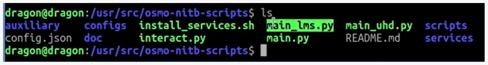
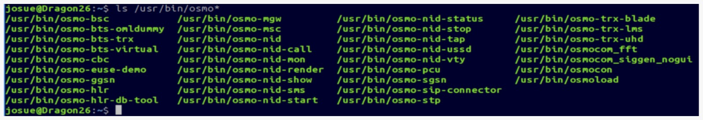

# 1. Contexto: por qué no se puede replicar el tutorial

## El punto de partida

Como referencia se tomó un video en el que se levanta una red GSM con una LibreSDR Mini B220 y un teléfono Samsung GT-I9500, logrando incluso realizar una llamada.

!!! info "Video de referencia"
    [DragonOS FocalX LibreSDR (USRP) Hands On w/ Osmo NITB Scripts(UHD)](https://www.youtube.com/watch?v=Z4MMFjkNABk&list=PLXjRrYsXOd9eZ_cIpHja4_dZyPjNmDgul&index=4){ target="_blank" }

El tutorial usaba el programa `osmo-nitb` y un script de Python (`main_uhd.py`), que se ejecutaba así:

```bash
sudo ./main_uhd.py -u -d uhd --sip
```

Al intentar repetirlo en una versión moderna de DragonOS, esos componentes ya no están disponibles.

{ width="700" }
*Software utilizado en el video de referencia.*

## Qué cambió en Osmocom

`osmo-nitb` (*Network In The Box*) reunía toda la red celular en un solo programa. En las versiones actuales esa función se reparte en servicios independientes:

| Antes | Ahora |
|---|---|
| Un solo programa: `osmo-nitb` | Servicios separados: `osmo-hlr`, `osmo-msc`, `osmo-bsc`, `osmo-mgw`, `osmo-stp`, `osmo-bts-trx`, `osmo-trx` y otros |

## Qué se puede hacer

En DragonOS 26.01 la arquitectura ya viene dividida en esos servicios. La siguiente captura muestra los componentes de Osmocom instalados en el sistema:

{ width="700" }
*ls /usr/bin/osmo*

En lugar de los scripts antiguos, DragonOS incluye la suite **`osmo-nid`**, que levanta todos esos servicios de forma ordenada a partir de un único archivo de configuración. Estos son los comandos que se usan en esta documentación:

```bash
sudo osmo-nid-start    # Genera la configuración e inicia todos los servicios
sudo osmo-nid-stop     # Detiene los servicios
osmo-nid-mon           # Muestra los usuarios conectados
osmo-nid-call          # Prueba de llamada
osmo-nid-sms           # Prueba de SMS
osmo-nid-ussd          # Prueba de USSD
```

!!! info "Archivo de configuración"
    Todo se controla desde `/etc/osmo-nid/config.yml`. Es el archivo que se modifica en las siguientes etapas.
