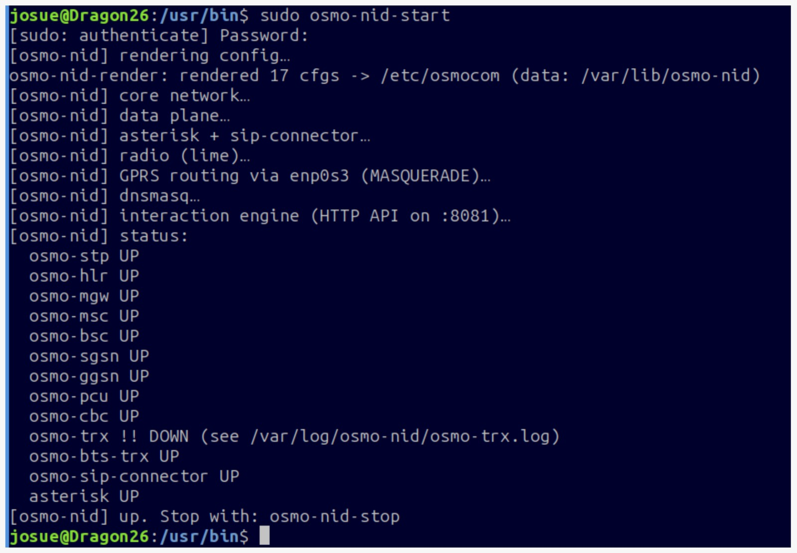
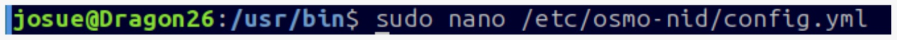
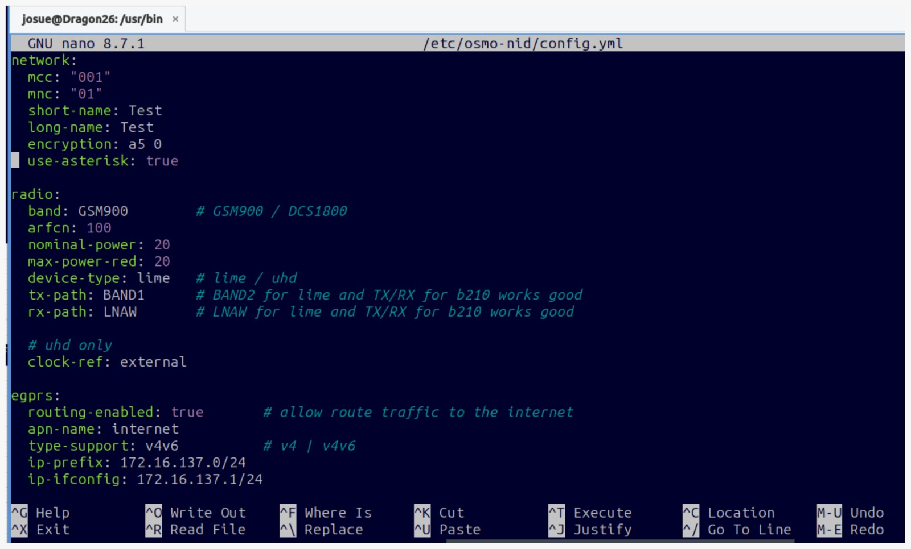
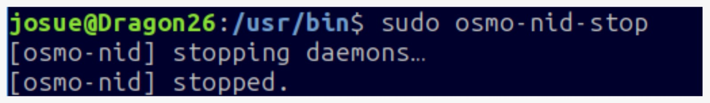
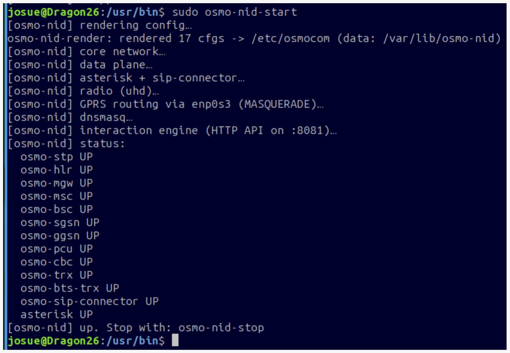

# 2. Despliegue de la red

## Primer arranque

```bash title="Terminal"
sudo osmo-nid-start
```

Casi todos los servicios aparecen como `UP`, pero el transceptor de radio falla y la línea de radio indica un equipo que no es el nuestro:

```text title="Salida de osmo-nid-start"
[osmo-nid] radio (lime)...
  osmo-trx !! DOWN (see /var/log/osmo-nid/osmo-trx.log)
```

El sistema intenta usar una **LimeSDR**, pero el equipo conectado es una LibreSDR Mini B220 que funciona con el driver **UHD**. Sin `osmo-trx` la antena no emite señal GSM.

{ width="500" }

*Primer arranque: el sistema selecciona el driver de LimeSDR por defecto.*

## Cambiar el driver a UHD

El tipo de radio se lee del archivo de configuración, así que hay que editarlo:

```bash title="Terminal"
sudo nano /etc/osmo-nid/config.yml
```

{width="500"}

*Uso del comando*

{ width="500" }

*Salida del comando*

En el bloque `radio` hay dos opciones de equipo (`lime` y `uhd`). Se cambia a `uhd`:

```yaml title="/etc/osmo-nid/config.yml"
radio:
  device-type: uhd    # lime / uhd
```


## Detener antes de modificar

Cada vez que se haya ejecutado `start` y se quiera cambiar algo, primero se detiene el sistema:

```bash title="Terminal"
sudo osmo-nid-stop
```

{ width="500" }

*Según el propio script, `stop` también restaura el límite de tiempo real del sistema que `start` modifica por seguridad.*

## Segundo arranque

```bash title="Terminal"
sudo osmo-nid-start
```

Ahora la salida indica `radio (uhd)...` y todos los servicios, incluido `osmo-trx`, aparecen en `UP`.

{ width="500" }

*Todos los servicios activos con el driver UHD.*

| Servicio | Función |
|---|---|
| `osmo-trx` | Transceptor: envía y recibe las muestras de radiofrecuencia a través de la SDR |
| `osmo-bts-trx` | Estación base de la celda 2G |
| `osmo-hlr` | Registro de suscriptores |
| `osmo-msc` | Central de conmutación |
| `osmo-bsc`, `osmo-mgw`, `osmo-stp` | Control de estaciones base, medios y señalización |
| `osmo-sgsn`, `osmo-ggsn`, `osmo-pcu`, `osmo-cbc` | Datos GPRS/EGPRS y difusión celular |
| `asterisk`, `osmo-sip-connector` | Central telefónica VoIP para voz |

!!! warning "Servicios UP no significa red visible"
    Con todos los servicios activos el teléfono todavía no detectaba la red. Eso se resuelve en la siguiente etapa.
