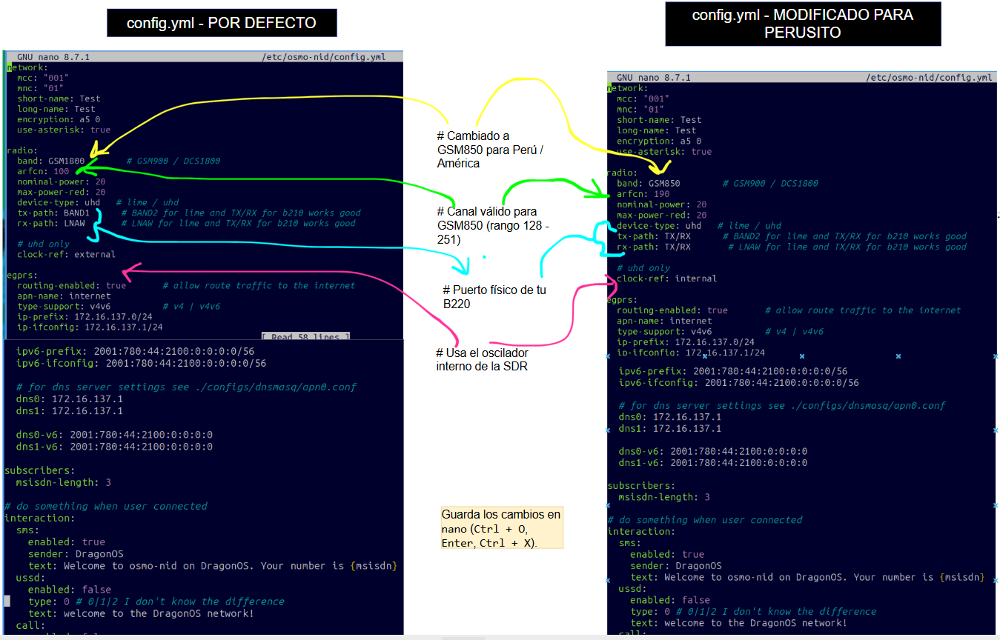
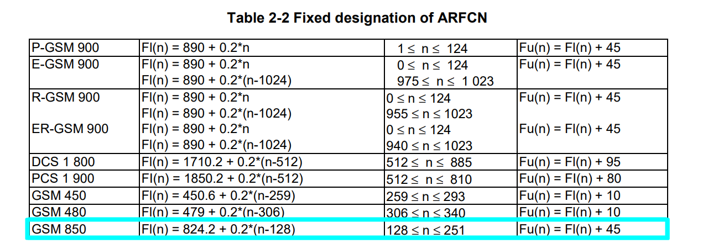
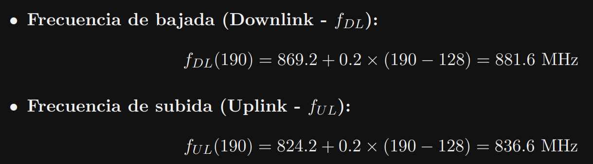

# 3. Configuración para Perú

## El problema

Todos los servicios estaban `UP`, pero la red no aparecía en la búsqueda del teléfono. La configuración por defecto de `config.yml` está pensada para otro equipo y otra banda, así que se modificaron cinco parámetros del bloque `radio`.

## Comparación: por defecto frente a modificado

| Parámetro | Por defecto | Modificado | Motivo |
|---|---|---|---|
| `band` | `GSM900` | `GSM850` | Banda GSM de la región (Perú y América) |
| `arfcn` | `100` | `190` | Canal válido dentro de GSM 850 (rango 128 a 251) |
| `tx-path` | `BAND1` | `TX/RX` | Puerto físico de la B220; `BAND1` corresponde a LimeSDR |
| `rx-path` | `LNAW` | `TX/RX` | Puerto físico de la B220; `LNAW` corresponde a LimeSDR |
| `clock-ref` | `external` | `internal` | Usa el oscilador interno de la SDR; no hay reloj externo conectado |

Los propios comentarios del archivo respaldan los puertos: indican que `TX/RX` funciona bien para equipos de la familia B210.

Los mismos cambios, vistos en el archivo (en rojo lo que se quitó y en verde lo que se puso):

```diff title="/etc/osmo-nid/config.yml"
 radio:
-  band: GSM900
+  band: GSM850
-  arfcn: 100
+  arfcn: 190
-  tx-path: BAND1
+  tx-path: TX/RX
-  rx-path: LNAW
+  rx-path: TX/RX
-  clock-ref: external
+  clock-ref: internal
```


*Izquierda: configuración por defecto. Derecha: configuración modificada.*

!!! note "Alcance de la prueba"
    Los cinco cambios se aplicaron juntos. No se probó cada uno por separado, por lo que esta documentación no establece cuál fue el determinante para que la red apareciera.

## ¿Qué es el ARFCN?

El **ARFCN** (*Absolute Radio Frequency Channel Number*) es un número que identifica de forma única un canal de radiofrecuencia en las redes móviles.

| Para qué sirve | |
|---|---|
| Identificar frecuencias | Teléfonos y estaciones base reconocen un canal exacto sin confusión |
| Búsqueda inicial de red | El dispositivo escanea el espectro y se conecta a una señal válida |
| Planificación | Ayuda a organizar el espectro y evitar interferencias entre canales |

Cada generación adapta el concepto con otro nombre:

| Tecnología | Nombre |
|---|---|
| 2G (GSM) | ARFCN |
| 3G (UMTS) | UARFCN |
| 4G (LTE) | EARFCN |
| 5G (NR) | NR-ARFCN |

## Frecuencias de GSM 850

Para GSM 850 los canales van del 128 al 251, con 200 kHz por canal y 45 MHz de separación entre subida y bajada:
{ width="600" }

*Tabla GSM850*


| ARFCN | Subida (UL) | Bajada (DL) |
|---|---|---|
| 128 (inicio de banda) | 824.2 MHz | 869.2 MHz |
| **190 (elegido)** | **836.6 MHz** | **881.6 MHz** |
| 251 (fin de banda) | 848.8 MHz | 893.8 MHz |

!!! info "Referencia"
    [3GPP TS 45.005, *Radio transmission and reception*](https://www.etsi.org/deliver/etsi_ts/145000_145099/145005/16.01.00_60/ts_145005v160100p.pdf){ target="_blank" }
    <br>[Table 2-2. Pagina 18]

## Por qué el canal 190

En la norma GSM 850, la banda abarca los canales del **128 al 251**. Si aplicamos la fórmula oficial del 3GPP para el canal 190:

{ width="500" }

Dado que el rango total de bajada va de **869.2 MHz a 893.8 MHz**, el centro exacto de la banda es **881.5 MHz**. El ARFCN 190 (881.6 MHz) se ubica casi en el centro geométrico del espectro.

!!! warning "Canal libre de operadores comerciales"
    En un entorno real, la elección de un canal también debe evitar los que ocupan las torres comerciales.

Con estos cambios la red ya transmite en GSM 850 y el siguiente paso es configurar el teléfono.
