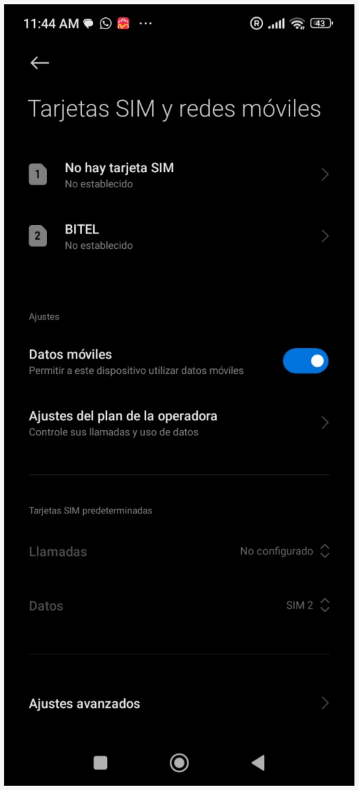
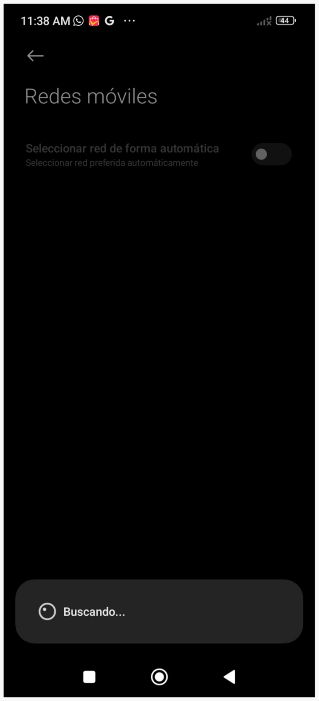
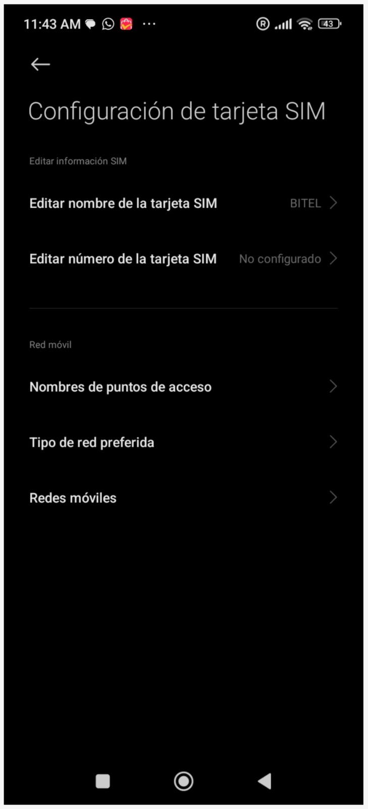
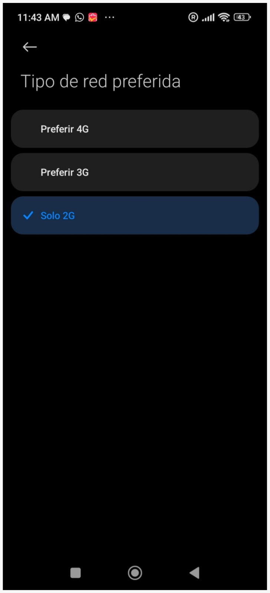
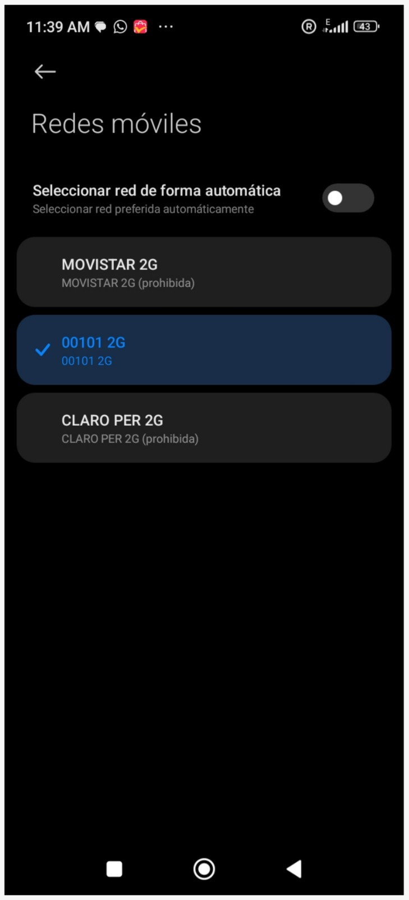
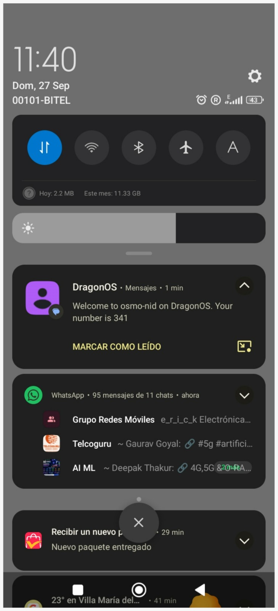

# 4. Configuración del teléfono

Se utilizó un Xiaomi Redmi 13C con una SIM comercial. El teléfono se limita a 2G y se busca la red de forma manual.

### Paso 1: Ubicar el apartado de Tarjetas SIM en nuestro telefono

{ width="300" }

### Paso 1.1: Ahora nos encontramos en el menú de configuración de tarjeta SIM

{ width="300" }
 
### Paso 2: Seleccionar el tipo de red preferida

{ width="300" }

### Paso 3: Desactivar la opcion de "Seleccionar red de forma automatica

Aca nuestro telefono comenzará a buscar redes 2G

{ width="300" }

### Paso 4: Seleccionamos nuestra red 2G

{ width="300" }

### Paso 5: Nos llegará un sms por defecto

Este sms se encontraba dentro del codigo de Osmocom. No hizo falta que añadamos nada.

{ width="300" }
