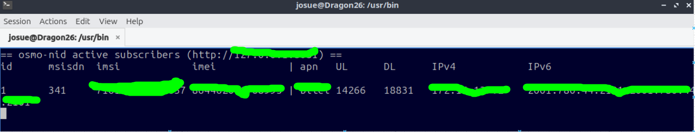
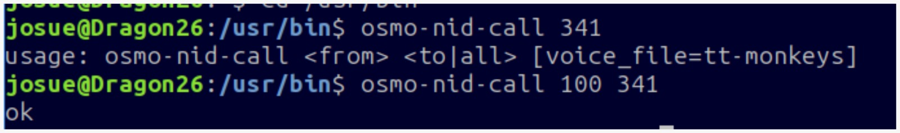

# 5. Verificación: usuarios conectados y llamada de prueba

Con la red en marcha se abre **otra terminal** (sin cerrar la que ejecutó `osmo-nid-start`) y se usa el comando de monitoreo:

```bash
osmo-nid-mon
```

Cuando el teléfono se registra en la celda, aparece en esta lista con el número que la red le asignó.

### Observación 1: Uso del comando

Comando usado para abrir la lista de usuarios conectados a la red

{ width="700" }

### Observación 2: Lista de usuarios

{ width="700" }

### Observación 3: Llamada de prueba

El mensaje indica que el comando necesita dos argumentos obligatorios: **quién llama** (`<from>`) y **quién recibe** (`<to>`).

Para realizar la llamada a nuestro celular (`341`), pasa un número o nombre como remitente ejecutando:

```bash
osmo-nid-call 100 341
```

{ width="700" }

Debería llegarnos una llamada del numero 100, tal y como se mostró al inicio de esta pagina.
