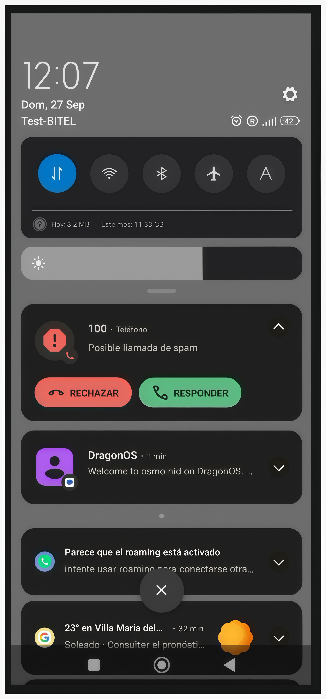

# Despliegue de una Red Privada GSM 2G mediante Osmocom y USRP B200: Validación de Autenticación Abierta con SIM Comercial

Esta documentación recoge, paso a paso, cómo se levantó una red móvil GSM 2G privada de laboratorio con la pila Osmocom en DragonOS, una SDR con driver UHD y un teléfono con SIM comercial.

{ width="300" }

*Telefono detectando la red GSM. Se observa la prueba de llamada final y en sms enviado*

## Resumen

Este proyecto tiene como objetivo desplegar e implementar una red celular privada 2G (GSM) utilizando la suite de software libre Osmocom. Se configuraron e integraron exitosamente los componentes principales de la red central y la estación base en un entorno de desarrollo controlado. Como resultado, se logró el registro de dispositivos móviles, el establecimiento de llamadas y la transmisión de mensajes cortos (SMS) dentro de la red privada. Este entorno permite el análisis, prueba y monitoreo del tráfico GSM para fines de investigación en redes móviles.

##Equipo y software

| Componente | Detalle |
|---|---|
| Sistema operativo | DragonOS 26.01 |
| Software de red | Suite `osmo-nid` (pila Osmocom: HLR, MSC, BSC, BTS, TRX, Asterisk) |
| SDR | LibreSDR Mini B220, con driver UHD (`osmo-trx-uhd`) |
| Teléfono | Xiaomi Redmi 13C, red configurada en solo 2G |
| SIM | Bitel 4G (comercial) |

## Contenido

| Etapa | Qué se hace |
|---|---|
| [1. Contexto](01-contexto.md) | Por qué el tutorial original ya no se puede replicar |
| [2. Despliegue de la red](02-despliegue.md) | Arranque de `osmo-nid` y cambio de driver a UHD |
| [3. Configuración para Perú](03-configuracion-peru.md) | Banda, ARFCN, puertos de RF y reloj |
| [4. Configuración del teléfono](04-telefono.md) | Búsqueda manual de la red en el Redmi 13C |
| [5. Verificación](05-verificacion.md) | Usuarios conectados a la red |
| [6. Aviso legal](06-aviso-legal.md) | Uso responsable del espectro |

!!! warning "Uso responsable"
    Esta red transmite en una banda licenciada. Lee el [aviso legal](06-aviso-legal.md) antes de reproducir este experimento.
